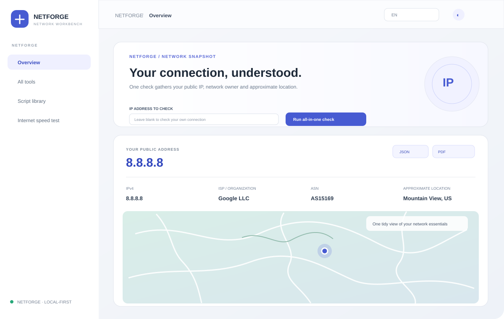

# NETFORGE — IP, Network and Internet Tools

NETFORGE is a lightweight, multilingual browser workbench for IP, DNS, network and browser utilities. English is the default language; Hungarian, German and Spanish are available from the language selector.

## Features

- All-in-one IPv4/IPv6 lookup with ISP, ASN, approximate location, OpenStreetMap, reverse DNS and downloadable JSON/TXT/PDF report.
- 60 focused utilities, including a separate MAC tools category.
- Internet speed test for HTTP response time, download and upload, using Cloudflare's public speed test service.
- Downloadable Python and PowerShell utilities. The single-file `netforge_local.py` starts the full site on localhost and enables one-packet ICMP ping.
- Responsive, light and dark themes.

## Run locally

Open `index.html` in a current browser. For local ICMP ping, run `python netforge_local.py`; the site opens at `http://127.0.0.1:8765`. Python 3.10+ is required for that optional local server. The hosted Vercel version is a static site and does not run server-side ping.

## Deploy to Vercel

1. Import `peter455663/ip-tool-NETFORGE` into Vercel.
2. Choose **Other** as the framework preset.
3. Leave the build command empty and use the repository root as the output directory.
4. Deploy. The repository includes `vercel.json` for a static deployment.

## Speed test and privacy

The speed test sends a small download and upload sample to Cloudflare's speed test endpoints. The result is an estimate of this browser's connection to Cloudflare; Wi-Fi, other traffic and routing affect it. The measured latency is HTTP round-trip time, not ICMP ping. See [Cloudflare's speed test information](https://speed.cloudflare.com/about).

IP information and map coordinates are approximate. IP lookups, DNS queries and MAC vendor lookup contact their named public providers directly from the browser. The site no longer includes an IP logger or visitor-capture endpoint.

## Language guides and interface previews

- [English](README.md) — [interface preview](docs/screenshots/home-en.svg)
- [Magyar](docs/README.hu.md) — [felületi előnézet](docs/screenshots/home-hu.svg)
- [Deutsch](docs/README.de.md) — [Oberflächenvorschau](docs/screenshots/home-de.svg)
- [Español](docs/README.es.md) — [vista previa](docs/screenshots/home-es.svg)

## Project files

The site is static HTML, CSS and JavaScript. `netforge_local.py` is an optional standard-library localhost server for local ping; it is not used by Vercel. No build step or API key is needed.

