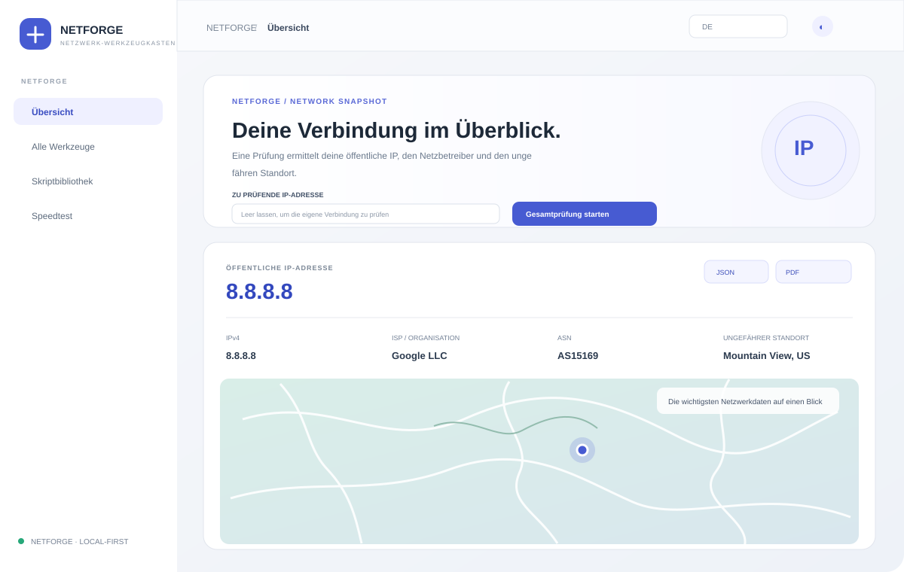

# NETFORGE — IP-, Netzwerk- und Internetwerkzeuge

NETFORGE ist eine mehrsprachige Sammlung von IP-, DNS-, Netzwerk- und Browserwerkzeugen, die direkt im Browser läuft. Englisch ist die Standardsprache; Ungarisch, Deutsch und Spanisch sind ebenfalls verfügbar.

## Funktionen

- IPv4- und IPv6-Gesamtprüfung mit ISP, ASN, ungefährem Standort, OpenStreetMap-Karte, Reverse DNS sowie JSON-, TXT- und PDF-Export.
- 60 gezielte Werkzeuge, einschließlich einer eigenen Kategorie für MAC-Adressen.
- Internet-Speedtest für HTTP-Antwortzeit, Download und Upload über den öffentlichen Cloudflare-Speedtest.
- Herunterladbare Python- und PowerShell-Werkzeuge. Die einzelne Datei `netforge_local.py` startet die vollständige Website auf localhost und ermöglicht einen einzelnen ICMP-Ping.
- Responsives Layout sowie heller und dunkler Modus.

## Lokal starten

Öffne `index.html` in einem aktuellen Browser. Für lokalen ICMP-Ping starte `python netforge_local.py`; die Seite ist anschließend unter `http://127.0.0.1:8765` verfügbar. Für diesen optionalen lokalen Server wird Python 3.10 oder neuer benötigt. Die Vercel-Version ist statisch und führt keinen serverseitigen Ping aus.

## Auf Vercel bereitstellen

1. Importiere `peter455663/ip-tool-NETFORGE` in Vercel.
2. Wähle **Other** als Framework-Voreinstellung.
3. Lass den Build-Befehl leer und verwende das Repository-Stammverzeichnis als Ausgabeverzeichnis.
4. Starte die Bereitstellung. Die statische Konfiguration liegt in `vercel.json`.

## Speedtest und Datenschutz

Der Test überträgt eine kleine Download- und Uploadprobe an die Speedtest-Endpunkte von Cloudflare. Das Ergebnis schätzt die Verbindung dieses Browsers zu Cloudflare; WLAN, andere Datenübertragungen und Routing beeinflussen es. Die Latenz ist eine HTTP-Antwortzeit und kein ICMP-Ping. Mehr dazu in den [Informationen zum Cloudflare-Speedtest](https://speed.cloudflare.com/about).

IP-Daten und Kartenkoordinaten sind ungefähr. IP-, DNS- und MAC-Herstellerabfragen kontaktieren die genannten öffentlichen Anbieter direkt. Die Website enthält keinen IP-Logger und keinen Endpunkt zur Besucheraufzeichnung.

## Sprachen und Oberflächenvorschauen

- [English](../README.md) — [interface preview](screenshots/home-en.svg)
- [Magyar](README.hu.md) — [felületi előnézet](screenshots/home-hu.svg)
- [Deutsch](README.de.md) — [Oberflächenvorschau](screenshots/home-de.svg)
- [Español](README.es.md) — [vista previa](screenshots/home-es.svg)

