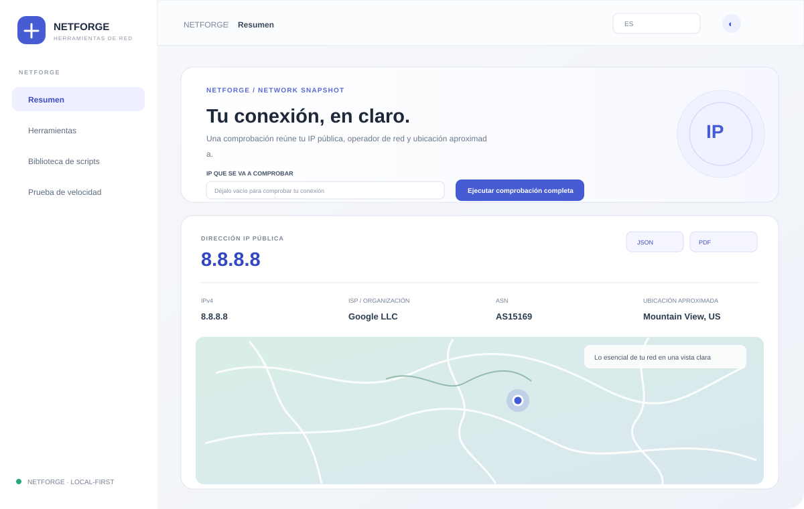

# NETFORGE — herramientas de IP, red e Internet

NETFORGE es un conjunto multilingüe de utilidades de IP, DNS, red y navegador que funciona directamente en el navegador. El inglés es el idioma predeterminado; también puedes elegir húngaro, alemán o español.

## Funciones

- Comprobación IPv4/IPv6 completa con ISP, ASN, ubicación aproximada, mapa de OpenStreetMap, DNS inverso y exportación JSON, TXT y PDF.
- 60 utilidades específicas, con una categoría propia para direcciones MAC.
- Prueba de velocidad de Internet: respuesta HTTP, descarga y subida mediante el servicio público de Cloudflare.
- Utilidades descargables para Python y PowerShell. El archivo único `netforge_local.py` inicia el sitio completo en localhost y permite un ping ICMP individual.
- Diseño adaptable con temas claro y oscuro.

## Ejecución local

Abre `index.html` en un navegador actualizado. Para habilitar el ping ICMP local, ejecuta `python netforge_local.py`; el sitio se abrirá en `http://127.0.0.1:8765`. El servidor local opcional requiere Python 3.10 o posterior. La versión de Vercel es estática y no ejecuta ping en el servidor.

## Publicar en Vercel

1. Importa `peter455663/ip-tool-NETFORGE` en Vercel.
2. Elige **Other** como framework.
3. Deja vacío el comando de compilación y usa la raíz del repositorio como directorio de salida.
4. Publica el proyecto. La configuración estática se encuentra en `vercel.json`.

## Prueba de velocidad y privacidad

La prueba envía muestras pequeñas de descarga y subida a los endpoints de velocidad de Cloudflare. El resultado estima la conexión de este navegador con Cloudflare; el Wi‑Fi, otra actividad y el enrutamiento influyen. La latencia es el tiempo de respuesta HTTP, no un ping ICMP. Consulta la [información de la prueba de Cloudflare](https://speed.cloudflare.com/about).

Los datos de IP y las coordenadas del mapa son aproximados. Las consultas IP, DNS y de fabricante MAC contactan directamente con los proveedores públicos indicados. El sitio ya no incluye un registrador de IP ni un endpoint que recopile datos de visitantes.

## Idiomas y vistas previas

- [English](../README.md) — [vista previa](screenshots/home-en.svg)
- [Magyar](README.hu.md) — [felületi előnézet](screenshots/home-hu.svg)
- [Deutsch](README.de.md) — [Oberflächenvorschau](screenshots/home-de.svg)
- [Español](README.es.md) — [vista previa](screenshots/home-es.svg)

