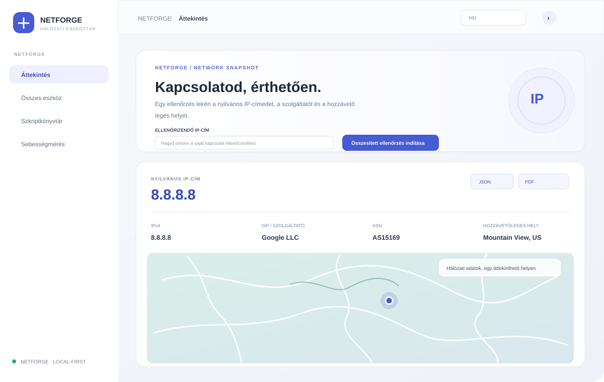

# NETFORGE — IP-, hálózati és internetes eszközök

A NETFORGE többnyelvű, böngészőben futó IP-, DNS-, hálózati és böngészőeszköz-tár. Az alapértelmezett nyelv az angol; magyar, német és spanyol nyelv is választható.

## Funkciók

- IPv4- és IPv6-ellenőrzés egy lépésben: ISP, ASN, hozzávetőleges földrajzi hely, OpenStreetMap-térkép, fordított DNS, valamint JSON-, TXT- és PDF-mentés.
- 60 célzott eszköz, külön MAC-eszközkategóriával.
- Internetsebesség-mérés HTTP-válaszidővel, letöltéssel és feltöltéssel a Cloudflare nyilvános sebességmérő szolgáltatásával.
- Letölthető Python- és PowerShell-eszközök. Az egyfájlos `netforge_local.py` localhoston indítja el a webhelyet, és egycsomagos ICMP pinget is biztosít.
- Reszponzív megjelenés, világos és sötét témával.

## Helyi futtatás

Nyisd meg az `index.html` fájlt egy friss böngészőben. A helyi ICMP pinghez indítsd el a `python netforge_local.py` parancsot; az oldal a `http://127.0.0.1:8765` címen nyílik meg. Ehhez a kiegészítő helyi kiszolgálóhoz Python 3.10 vagy újabb kell. A Vercel-verzió statikus webhely, ott a szerveroldali ping nem fut.

## Telepítés Vercelre

1. Importáld a `peter455663/ip-tool-NETFORGE` tárolót a Vercelbe.
2. Keretrendszerként válaszd az **Other** lehetőséget.
3. Hagyd üresen a build parancsot, a kimeneti könyvtár pedig a tároló gyökere legyen.
4. Indítsd el a telepítést. A statikus beállításokat a `vercel.json` tartalmazza.

## Sebességteszt és adatvédelem

A sebességteszt kis letöltési és feltöltési mintát küld a Cloudflare sebességteszt-végpontjaira. Az eredmény a böngésző és a Cloudflare közötti kapcsolat becslése; a Wi-Fi, az egyéb forgalom és az útvonal is befolyásolja. A mért késleltetés HTTP-válaszidő, nem ICMP ping. Részletek: [Cloudflare sebességteszt-tájékoztatója](https://speed.cloudflare.com/about).

Az IP-adatok és a térképen látható koordináták hozzávetőlegesek. Az IP-, DNS- és MAC-gyártó keresések közvetlenül a megnevezett nyilvános szolgáltatóknak küldenek lekérdezést. A webhelyen nincs IP-naplózó vagy látogatóadat-rögzítő végpont.

## Nyelvek és felületi előnézetek

- [English](../README.md) — [felületi előnézet](screenshots/home-en.svg)
- [Magyar](README.hu.md) — [felületi előnézet](screenshots/home-hu.svg)
- [Deutsch](README.de.md) — [Oberflächenvorschau](screenshots/home-de.svg)
- [Español](README.es.md) — [vista previa](screenshots/home-es.svg)

